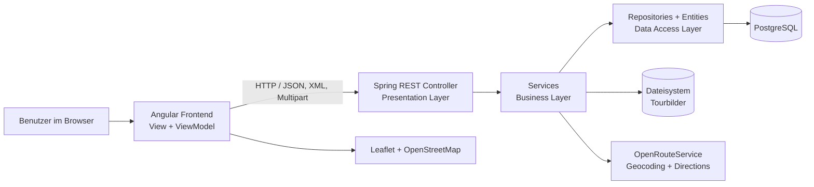
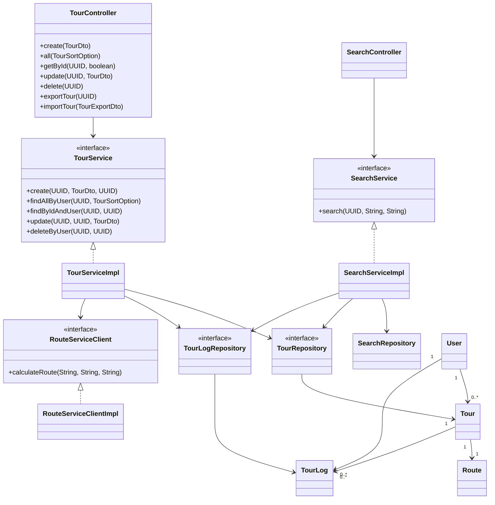
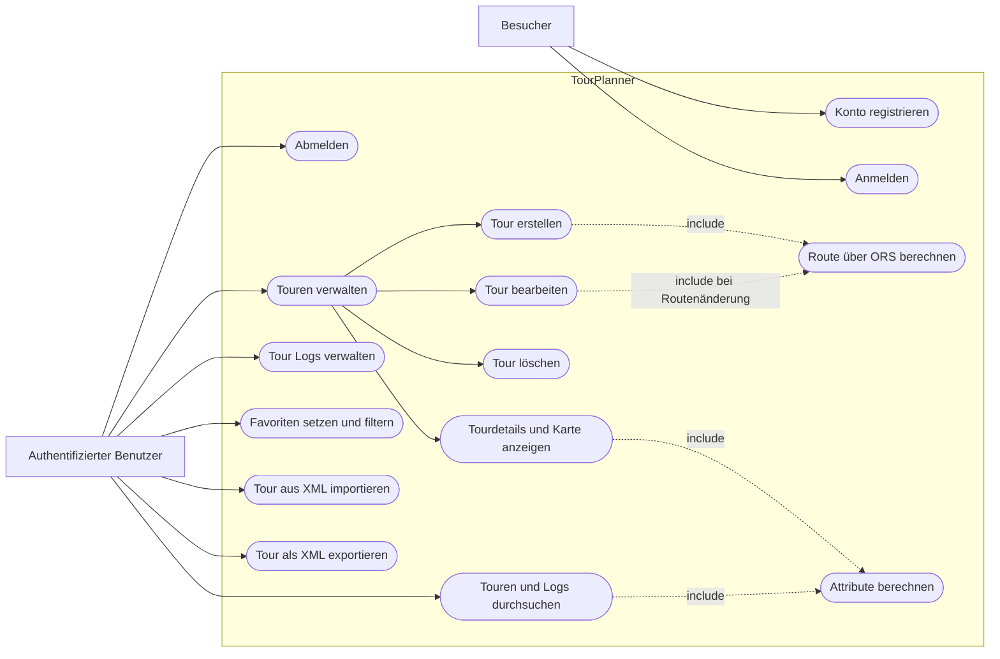
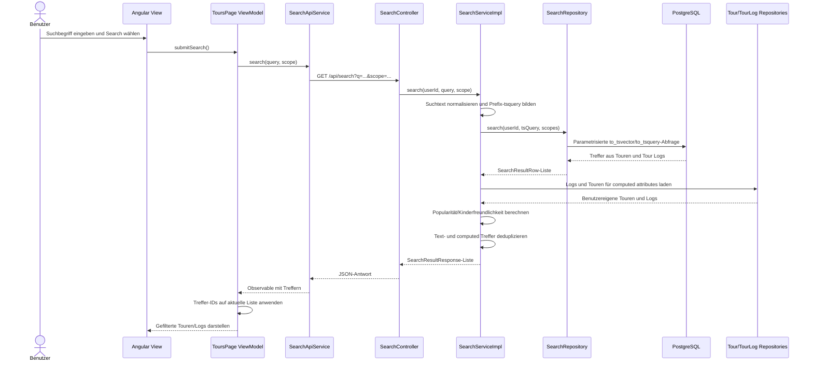
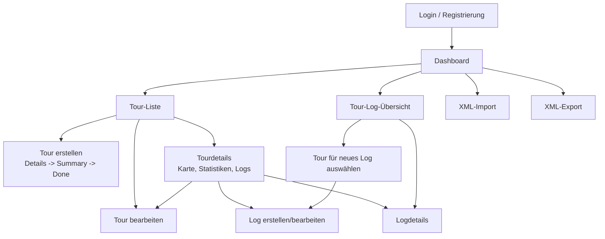
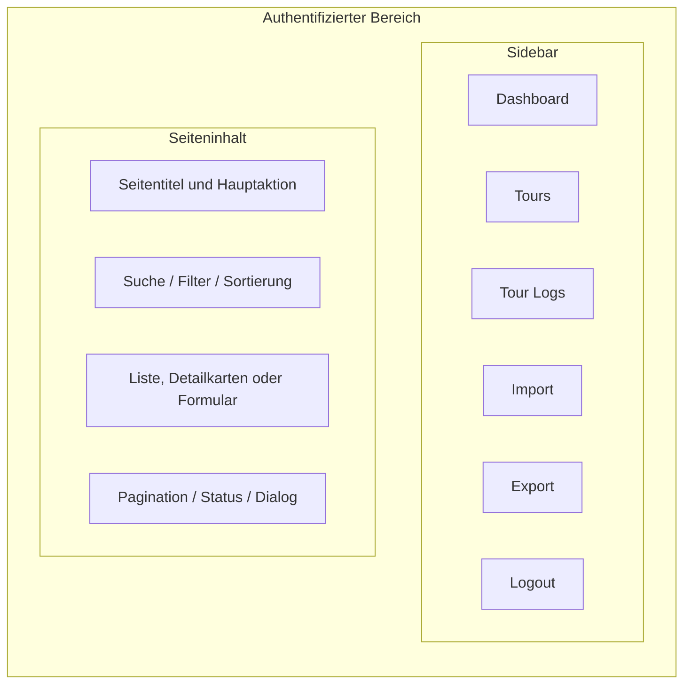
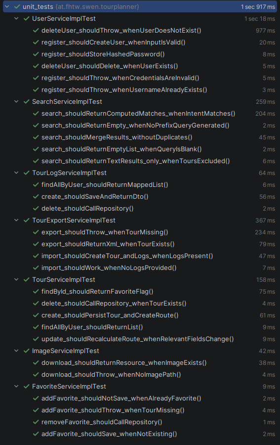
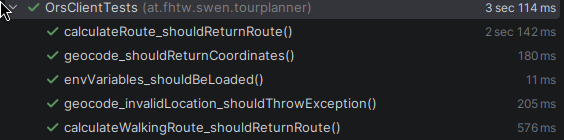
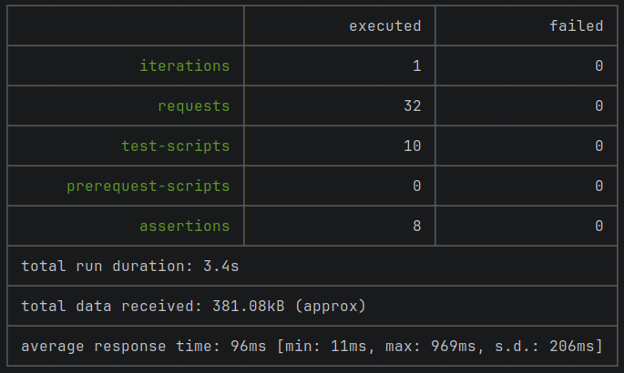
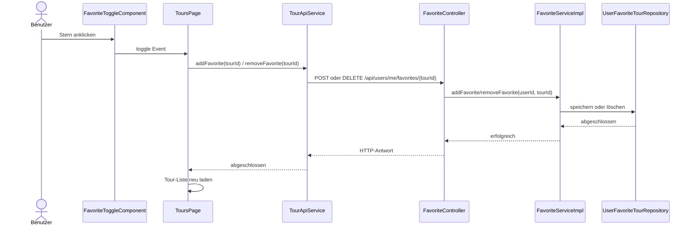

# TourPlanner - Finales Projektprotokoll

**Lehrveranstaltung:** SWEN2, SS 2026  
**Projektteam:** Michael Stangl, Wenhao Wen  
**Dokumentstand:** 14. Juni 2026  
**Repository:** [gitlab.com/mic_ed/tour_planner](https://gitlab.com/mic_ed/tour_planner)

## Abdeckung der Bewertungspunkte

| Geforderter Punkt                                        | Abschnitt im Protokoll |
| -------------------------------------------------------- | ---------------------- |
| App-Architektur, Schichten, Inhalte und Klassendiagramme | Abschnitt 2            |
| Use Cases, Use-Case- und Sequenzdiagramm                 | Abschnitt 3            |
| UX und Wireframes                                        | Abschnitt 4            |
| Bibliotheksentscheidungen und Lessons Learned            | Abschnitt 5            |
| Implementierte Design Patterns                           | Abschnitt 6            |
| Unit-Testing-Entscheidungen                              | Abschnitt 7            |
| Unique Feature                                           | Abschnitt 8            |
| Zeitaufzeichnung                                         | Abschnitt 9            |
| Git-Link und Entwicklungsprozess                         | Abschnitt 10           |

## 1. Projektüberblick

TourPlanner ist eine webbasierte Client-Server-Anwendung zur Verwaltung von Touren
und den dazugehörigen Tour Logs. Benutzer können sich registrieren und anmelden,
Touren erstellen, bearbeiten, löschen, durchsuchen, importieren und exportieren.
Für jede Tour werden eine Route, Distanz und Dauer über OpenRouteService ermittelt
und mit Leaflet auf einer Karte dargestellt.

Tour Logs dokumentieren absolvierte Touren. Aus diesen Einträgen berechnet die
Anwendung unter anderem Popularität und Kinderfreundlichkeit. Als zusätzliche
Funktion können Touren als Favoriten markiert und entsprechend gefiltert werden.

### 1.1 Technologieüberblick

| Bereich        | Technologie                               |
| -------------- | ----------------------------------------- |
| Frontend       | Angular 21, TypeScript 5.9, RxJS 7.8      |
| UI-Komponenten | PrimeNG 21, PrimeIcons                    |
| Kartenansicht  | Leaflet 1.9, OpenStreetMap Tiles          |
| Backend        | Java 25, Spring Boot 4                    |
| Persistenz     | PostgreSQL 17, Spring Data JPA, Hibernate |
| Sicherheit     | Spring Security, JWT, BCrypt              |
| Externe API    | OpenRouteService Directions und Geocoding |
| Import/Export  | XML über Jackson XML                      |
| Logging        | SLF4J und Logback                         |
| Tests          | JUnit 5 und Mockito                       |
| Infrastruktur  | Docker Compose                            |

## 2. Anwendungsarchitektur

### 2.1 Gesamtarchitektur

Die Anwendung ist als Two-Tier-Webanwendung aufgebaut. Das Angular-Frontend
kommuniziert über HTTP mit dem Spring-Boot-Backend. Das Backend kapselt
Geschäftslogik, Persistenz, Authentifizierung und externe Dienste.



Die reguläre Abhängigkeitsrichtung lautet:

```text
Angular Template -> Angular Component -> Angular API Service
-> REST Controller -> Service Interface/Implementation
-> Repository -> PostgreSQL
```

### 2.2 Frontend-Schichten und Verantwortlichkeiten

Das Frontend ist featureorientiert aufgebaut:

| Ordner                | Inhalt und Aufgabe                                                                             |
| --------------------- | ---------------------------------------------------------------------------------------------- |
| `core/`               | Globale Konfiguration, Auth Guard, Pending-Changes Guard, HTTP-Interceptor und Session-Service |
| `shared/`             | Wiederverwendbare Komponenten wie App Shell, Sidebar, Dialoge, Breadcrumb und Pagination       |
| `features/auth/`      | Registrierung, Login und Auth-API                                                              |
| `features/tours/`     | Tour-Liste, Details, Erstellung, Bearbeitung, Modelle und API-Service                          |
| `features/tour-logs/` | Tour-Log-Liste, Auswahl, Erstellung, Bearbeitung und Detailansicht                             |
| `features/import/`    | XML-Import                                                                                     |
| `features/export/`    | XML-Export                                                                                     |

Angular wird im Projekt im Sinne von MVVM eingesetzt:

- **View:** HTML-Templates und CSS
- **ViewModel:** Component-Klassen mit Signals, Reactive Forms und Event-Handlern
- **Model:** TypeScript-Interfaces, Feature-Services und API-Antwortmodelle

Die View greift nicht direkt auf HTTP oder Persistenz zu. Sie bindet an Properties,
Signals und Form Controls des ViewModels. Das ViewModel delegiert Serverzugriffe
an injizierte API-Services.

### 2.3 Backend-Schichten und Verantwortlichkeiten

| Paket                    | Schicht            | Aufgabe                                                                               |
| ------------------------ | ------------------ |---------------------------------------------------------------------------------------|
| `controller`             | Presentation Layer | REST-Endpunkte, Request-Parameter, Authentifizierungsinformationen und HTTP-Antworten |
| `service`                | Business Layer     | Geschäftslogik, Interfaces, DTOs und Mapper                                           |
| `service.impl`           | Business Layer     | Tour-, Log-, Such-, Routing-, Bild-, Auth- und Import/Export-Logik                    |
| `persistence.entity`     | Data Access Layer  | JPA-Entitäten und Datenbankabbildung                                                  |
| `persistence.repository` | Data Access Layer  | Spring-Data-Repositories, zugehörige Adapter und parametrisierte Volltextsuche        |
| `security`               | Querschnitt        | JWT-Erzeugung, Filter, Security Context und BCrypt                                    |
| `util`                   | Querschnitt        | Logger-Verwaltung und UUIDv7                                                          |

Controller rufen Services auf. Services verwenden Repositories oder abstrahierte
Clients. Direkte Datenbankzugriffe aus Controllern oder Angular-Komponenten werden
dadurch vermieden.

### 2.4 Zentrale Klassen



Das Datenbankschema ist in [`backend/docs/db.puml`](../backend/docs/db.puml) dokumentiert.

### 2.5 Wichtige technische Abläufe

#### Tour erstellen

1. Der Benutzer füllt im Angular-Formular Name, Beschreibung, Start, Ziel und Typ aus.
2. Die Daten werden in einem Draft-Service gehalten und auf einer Summary-Seite geprüft.
3. `TourApiService` sendet die Daten an `POST /api/tours`.
4. `TourController` delegiert an `TourServiceImpl`.
5. Die Tour wird über `TourRepository` gespeichert.
6. `RouteServiceClientImpl` geokodiert Start und Ziel.
7. OpenRouteService liefert Distanz, Dauer und kodierte Routengeometrie.
8. Die Geometrie wird in Leaflet-Koordinaten dekodiert und als `Route` gespeichert.
9. Die Detailseite lädt Tour und Route und zeichnet die Route mit Leaflet.

#### Berechnete Tourattribute

Die Attribute werden aus den Tour Logs eines Benutzers berechnet:

- `logCount`: Anzahl der Logs
- `averageDifficulty`: durchschnittliche Schwierigkeit
- `averageTotalDistance`: durchschnittliche Gesamtdistanz
- `averageTotalTime`: durchschnittliche Gesamtzeit
- `popularity`: abgeleitet aus der Anzahl der Logs
- `childFriendliness`: abgeleitet aus Schwierigkeit, Zeit und Distanz

Die Werte werden nicht redundant in der Tour-Tabelle gespeichert. Sie werden aus
den aktuellen Logs berechnet und sind dadurch nach Änderungen sofort konsistent.

## 3. Use Cases

### 3.1 Akteure

Der primäre Akteur ist der **registrierte Benutzer**. Nicht authentifizierte Besucher
können ein Konto anlegen oder sich anmelden. Touren und Logs sind jeweils dem
erstellenden Benutzer zugeordnet und werden nicht zwischen Benutzern geteilt.

### 3.2 Use-Case-Diagramm



### 3.3 Beschreibung zentraler Use Cases

#### UC-01: Benutzer registrieren und anmelden

**Vorbedingung:** Der Benutzer besitzt noch kein Konto beziehungsweise ist abgemeldet.  
**Ablauf:** Registrierung mit Benutzername, E-Mail und Passwort; Passwort wird mit
BCrypt gehasht. Beim Login werden die Daten geprüft, ein JWT erzeugt und eine
Session gespeichert.  
**Ergebnis:** Der Benutzer erhält Zugriff auf geschützte Routen.

#### UC-02: Tour erstellen

**Vorbedingung:** Benutzer ist angemeldet.  
**Ablauf:** Eingabe der Tourdaten, Formularvalidierung, Summary-Prüfung,
Server-Persistenz und ORS-Routenberechnung.  
**Ergebnis:** Tour und Route sind gespeichert; die Tour ist in der Liste und
Detailansicht verfügbar.

#### UC-03: Tour Log verwalten

**Vorbedingung:** Eine Tour des Benutzers existiert.  
**Ablauf:** Log mit Datum, Bewertung, Schwierigkeit, Distanz, Zeit und Kommentar
erstellen; vorhandene Logs anzeigen, bearbeiten oder löschen.  
**Ergebnis:** Logdaten sind gespeichert und beeinflussen die berechneten
Tourattribute.

#### UC-04: Volltextsuche ausführen

**Vorbedingung:** Benutzer ist angemeldet.  
**Ablauf:** Suchtext eingeben und optional den Scope auf Touren oder Logs
begrenzen. Das Backend sucht in Textfeldern und berücksichtigt Suchbegriffe für
Popularität und Kinderfreundlichkeit.  
**Ergebnis:** Die UI zeigt nur passende Touren oder Logs.

#### UC-05: Tour importieren oder exportieren

**Export:** Tour und zugehörige Logs werden in ein XML-Dokument serialisiert und
als Datei heruntergeladen.  
**Import:** Eine XML-Datei wird gelesen; Tour und Logs erhalten neue IDs und werden
dem aktuell angemeldeten Benutzer zugeordnet.

### 3.4 Sequenzdiagramm der Volltextsuche



Die SQL-Abfrage verwendet benannte Parameter (`:query`, `:userId`) und keine
String-Konkatenation mit Benutzereingaben. Dadurch wird das Risiko von
SQL-Injection reduziert.

## 4. UX und Wireframes

### 4.1 UX-Ziele

Die Oberfläche verfolgt folgende Ziele:

- klare Trennung zwischen Listen-, Detail- und Formularseiten
- konsistente Navigation über App Shell und Sidebar
- kurze Wege zu häufigen Aktionen
- unmittelbares Feedback für Loading-, Error- und Empty-States
- Bestätigung vor destruktiven Aktionen
- Schutz vor dem unbeabsichtigten Verlassen nicht gespeicherter Formulare
- responsives Layout für Desktop, Tablet und schmale Bildschirme

### 4.2 Navigation und UI-Flow



### 4.3 Wireframe: allgemeine App Shell



### 4.4 Wireframe: Tour-Liste

```text
+------------------------------------------------------------------+
| My Tours                                      [ + New Tour ]      |
| Manage, edit and analyze your created tours.                     |
+------------------------------------------------------------------+
| [ Search tours........................ ] [Search] [Filter] [Sort] |
+------------------------------------------------------------------+
| Tour name                                       [Favorite star]   |
| Popularity / Child-friendly                                      |
| Tour ID                 Tour Type                                 |
|                                      [View] [Edit] [Delete]       |
+------------------------------------------------------------------+
|                          Pagination                              |
+------------------------------------------------------------------+
```

Bei mittleren und kleinen Viewports wird die Filterleiste in mehrere Zeilen
umgebrochen. Buttons und Select-Felder nehmen dann die verfügbare Breite ein.

### 4.5 Wireframe: Tourdetails

```text
+------------------------------------------------------------------+
| <- Tour Details                    [Favorite] [Edit] [Delete]     |
+------------------------------------------------------------------+
|                         Leaflet map                              |
|             Start marker ---- route ---- end marker              |
+--------------------------------+---------------------------------+
| Route details                  | Statistics                      |
| Distance / estimated time      | Popularity / child-friendliness |
+--------------------------------+---------------------------------+
| Name, description, type, from, to, averages, uploaded image      |
+------------------------------------------------------------------+
| Tour Logs             [Search logs] [Search] [ + New Tour Log ]  |
| Log cards with detail/edit/delete actions                         |
+------------------------------------------------------------------+
```

Ausführlichere ursprüngliche Wireframes und UX-Überlegungen befinden sich im
[`MIDTERM_PROTOCOLL.pdf`](MIDTERM_PROTOCOLL.pdf). Das vorliegende Protokoll
aktualisiert diese Beschreibung um die später implementierten Such-,
Import-/Export- und Routing-Funktionen.

### 4.6 Wiederverwendbare UI-Komponenten

Eigene Angular-Komponenten reduzieren Duplikation und halten Verhalten konsistent:

- `AppShellComponent`: gemeinsames Layout und Logout-Event
- `SidebarComponent`: Navigation
- `ConfirmDialogComponent`: Lösch- und Leave-Confirmation
- `FavoriteToggleComponent`: Favoritenstatus und Loading-State
- `PaginationComponent`: einheitliche Pagination
- `PageBreadcrumbComponent`: Orientierung in Detail- und Formularseiten
- `ImagePreviewDialogComponent`: Bildvorschau
- `FormFieldErrorComponent`: einheitliche Fehlermeldungen

## 5. Bibliotheksentscheidungen und Lessons Learned

### 5.1 Bibliotheksentscheidungen

| Bibliothek/Technologie     | Entscheidung und Begründung                                                                                                                              |
| -------------------------- | -------------------------------------------------------------------------------------------------------------------------------------------------------- |
| Angular                    | Vorgabe der Aufgabenstellung; Reactive Forms, Router, Guards und Dependency Injection unterstützen eine klare MVVM-nahe Struktur.                        |
| PrimeNG                    | Liefert zugängliche Standardkomponenten wie Buttons, Password Field und Paginator, ohne das projektspezifische Layout vorzugeben.                        |
| RxJS                       | Standard für asynchrone Angular-HTTP-Flows; `finalize`, `switchMap` und `forkJoin` reduzieren verschachtelte Callbacks.                                  |
| Leaflet                    | Leichtgewichtig, frameworkunabhängig und für GeoJSON/Polylines geeignet; wird dynamisch geladen, um serverseitige Initialisierungsprobleme zu vermeiden. |
| Spring Boot                | Vorgabe und geeignet für REST, Security, Konfiguration und Dependency Injection.                                                                         |
| Spring Data JPA/Hibernate  | Reduziert Boilerplate für CRUD und bildet Entitäten auf PostgreSQL ab.                                                                                   |
| NamedParameterJdbcTemplate | Für die PostgreSQL-spezifische Volltextsuche war eine explizite, parametrisierte SQL-Abfrage klarer als eine komplexe JPA-Abstraktion.                   |
| PostgreSQL                 | Vorgabe; bietet zusätzlich `to_tsvector` und `to_tsquery` für echte Volltextsuche.                                                                       |
| Jackson XML                | Nutzt dieselben DTO-Prinzipien wie JSON und ermöglicht einen verständlichen XML-Import/Export.                                                           |
| JJWT                       | Kapselt JWT-Erzeugung und Parsing für stateless Authentication.                                                                                          |
| BCrypt                     | Passwörter werden nicht im Klartext gespeichert; BCrypt enthält Salt und Work Factor.                                                                    |
| SLF4J/Logback              | Trennung zwischen Logging-API und Implementierung, Rolling File Appender und konfigurierbare Log-Level.                                                  |
| JUnit/Mockito              | Isolierte Tests der Business-Logik durch gemockte Repositories und externe Clients.                                                                      |

### 5.2 Lessons Learned

1. **API-Verträge müssen früh stabilisiert werden.**  
   Änderungen von `transportType` zu `tourType` und später zu einem Enum erforderten
   Anpassungen in Datenbank, Backend, Frontend und ORS-Mapping. Gemeinsame,
   dokumentierte DTOs und OpenAPI reduzieren solche Reibungsverluste.

2. **Externe APIs gehören hinter Interfaces.**  
   `RouteServiceClient` und `GeocodingServiceClient` machen die Business-Logik
   unabhängiger von OpenRouteService und lassen sich in Unit-Tests mocken.

3. **Berechnete Attribute sollten eine gemeinsame fachliche Quelle besitzen.**  
   Popularität und Kinderfreundlichkeit werden derzeit sowohl in `TourServiceImpl`
   als auch in `SearchServiceImpl` berechnet. Eine eigene
   `TourStatisticsService`-Komponente würde zukünftige Regeländerungen sicherer
   und duplikationsfrei machen.

4. **Responsive Design muss mit der real verfügbaren Content-Breite getestet werden.**  
   Die Sidebar reduziert den Platz stärker als die reine Browserbreite vermuten
   lässt. Deshalb benötigt die Tour-Filterleiste einen zusätzlichen Tablet-
   Breakpoint und nicht nur einen Mobile-Breakpoint.

5. **Unit- und Integrationstests müssen getrennt werden.**  
   Die ORS-Tests prüfen echte Konfiguration und Netzwerkaufrufe. Sie sind wertvoll,
   sollten aber getrennt von schnellen, deterministischen Unit-Tests ausführbar sein.

6. **Dokumentation muss parallel zum Code aktualisiert werden.**  
   Ältere Dokumente beschrieben noch Dummy-Routen oder nicht implementierte
   Features. Dieses Protokoll wurde deshalb anhand des aktuellen Codes und nicht
   anhand alter Statusnotizen erstellt.

7. **Konfiguration sollte umgebungsabhängig bleiben.**  
   Datenbankzugang, JWT Secret und ORS API Key werden bereits über
   Umgebungsvariablen geliefert. CORS-Origin, Tile-URL und Ports könnten künftig
   ebenfalls vollständig externalisiert werden.

## 6. Implementierte Design Patterns

### 6.1 Repository Pattern

Spring-Data-Repositories kapseln die Persistenz:

- `TourRepository`
- `TourLogRepository`
- `RouteRepository`
- `UserRepository`
- `SessionRepository`
- `UserFavoriteTourRepository`

Services formulieren fachliche Operationen und kennen keine JDBC-Verbindungsdetails.
Die Ausnahme ist die bewusst explizite `SearchRepository`, die eine parametrisierte
PostgreSQL-Volltextabfrage kapselt.

### 6.2 Dependency Injection

Controller und Services erhalten ihre Abhängigkeiten über Konstruktoren. Beispiele:

- `TourController` erhält `TourService` und `TourExportService`.
- `TourServiceImpl` erhält Repositories und `RouteServiceClient`.
- `RouteServiceClientImpl` erhält `GeocodingServiceClient`.

Dadurch können Implementierungen ausgetauscht und in Tests durch Mockito-Mocks
ersetzt werden.

### 6.3 Strategy/Bridge über Interfaces

Technische Implementierungen sind über Interfaces entkoppelt:

- `PasswordHasher` -> `BCryptPasswordHasher`
- `TokenService` -> `JwtTokenService`
- `RouteServiceClient` -> `RouteServiceClientImpl`
- `GeocodingServiceClient` -> `GeocodingServiceClientImpl`

Die Business-Logik hängt damit von Verträgen statt von konkreten Bibliotheken ab.

### 6.4 Mapper Pattern

`TourMapper`, `TourLogMapper`, `UserMapper` und `OrsProfileMapper` trennen
Entitäten, API-DTOs und externe ORS-Profile. Dadurch gelangen JPA-Entitäten nicht
direkt in die View.

### 6.5 Singleton Pattern

`LoggerService` stellt über `getInstance()` eine zentrale statische Instanz bereit
und cacht Logger pro Klasse. Logback selbst bleibt die eigentliche Logging-
Implementierung. Der Konstruktor ist derzeit öffentlich; damit ist die Verwendung
im Singleton-Stil implementiert, aber zusätzliche Instanzen werden technisch nicht
vollständig verhindert. Ein privater Konstruktor würde das Pattern strikt erzwingen.

### 6.6 MVVM-nahe Frontend-Struktur

Angular Templates dienen als View, Component-Klassen als ViewModel und
Feature-Services/Modelle als Model. Reactive Forms und Signals stellen die
Datenbindung zwischen View und ViewModel her.

## 7. Unit-Testing-Entscheidungen

### 7.1 Teststrategie

Der Schwerpunkt liegt auf Business-Logik und technischen Integrationspunkten.
Repositories und externe Clients werden in Unit-Tests gemockt. Dadurch sind die
Tests schnell und prüfen gezielt Entscheidungen der Service-Schicht.

Im Repository befinden sich **29** mit `@Test` markierte Unit-Tests in sieben Testklassen**.

| Testklasse                  | Anzahl | Begründung                                                                                        |
| --------------------------- |-------:| ------------------------------------------------------------------------------------------------- |
| `UserServiceImplTest`       |      6 | Registrierung, Duplikate, ungültige Daten, Löschen und Passwort-Hashing sind sicherheitskritisch. |
| `TourServiceImplTest`       |      5 | Tour-CRUD, Favoritenstatus und Neuberechnung der Route betreffen den Kern-Use-Case.               |
| `TourLogServiceImplTest`    |      3 | Logs sind Grundlage der berechneten Attribute und müssen benutzerbezogen persistiert werden.      |
| `SearchServiceImplTest`     |      5 | Normalisierung, Scopes, computed attributes und Deduplizierung sind fehleranfällige Logik.        |
| `TourExportServiceImplTest` |      4 | XML-Serialisierung sowie Import von Tour und Logs dürfen keine Daten verlieren.                   |
| `FavoriteServiceImplTest`   |      4 | Unique Feature: Hinzufügen, Entfernen und Verhalten bei fehlender Tour.                           |
| `ImageServiceImplTest`      |      2 | Dateisystemzugriff und fehlende Bilder benötigen kontrolliertes Fehlerverhalten.                  |
| **Gesamt**                  | **29** | Mehr als die geforderten 20 Tests.                                                                |



Weiters existiert eine Testklasse für den Integrationstest des ORS-Clients

| Testklasse                  | Anzahl | Begründung                                                                                        |
| --------------------------- |-------:| ------------------------------------------------------------------------------------------------- |
| `OrsClientTests`            |      5 | Prüft Konfiguration, Geocoding, Routing, Geometrie und ungültige Orte gegen die echte API.        |



Sämtliche API-Endpoints sind darüber hinaus mit dem 32 requests und 10 test-scripts umfassenden Tour_Postman.json testbar.




### 7.2 Warum diese Bereiche kritisch sind

- **Authentifizierung:** Fehler können Passwörter oder fremde Daten gefährden.
- **Benutzerzuordnung:** Touren und Logs dürfen nur dem Ersteller zugänglich sein.
- **Route:** Ein Fehler betrifft Distanz, Dauer und Kartenanzeige gleichzeitig.
- **Suche:** Sie kombiniert SQL, Scopes und berechnete Daten.
- **Import:** Fremde IDs dürfen nicht unverändert übernommen werden.
- **Computed attributes:** Änderungen an Logs müssen korrekte Statistiken ergeben.
- **Bildspeicherung:** Datenbankpfad und reale Datei müssen konsistent sein.

### 7.3 Abgrenzung und Verbesserungspotenzial

Die Mockito-Tests sind Unit-Tests. `OrsClientTests` und `Postman` sind dagegen Integrationstests,
weil sie `ORS_API_KEY`, Netzwerkzugriff und die reale API benötigen.

Sinnvolle nächste Verbesserungen:

- separate Maven-Profile für Unit- und Integrationstests
- Controller-Tests für HTTP-Status und Validierungsfehler
- Repository-Tests mit Testcontainers/PostgreSQL für die echte Volltextsuche
- Angular-Tests für Guards, Formulare und API-State-Handling
- gemeinsame Tests für die Grenzwerte von Popularität und Kinderfreundlichkeit

## 8. Unique Feature: Favoriten

Als Unique Feature wurde eine benutzerspezifische Favoritenverwaltung umgesetzt.

### 8.1 Funktionen

- Tour als Favorit markieren
- Favoritenstatus entfernen
- ausschließlich Favoriten anzeigen
- ausschließlich Nicht-Favoriten anzeigen
- Favoritenstatus in Tour-Liste und Detailseite anzeigen
- Loading-State während der Änderung
- Speicherung über die Zuordnungstabelle `user_favorite_tours`

### 8.2 Technischer Ablauf



Die Zuordnung enthält `user_id` und `tour_id` als zusammengesetzten Schlüssel.
Dadurch kann jeder Benutzer unabhängig eigene Favoriten verwalten.

## 9. Zeitaufzeichnung

Es wurde während der Entwicklung keine separate stundengenaue Zeiterfassung im
Repository geführt.

### 9.1 Git-Zeitdaten

| Kennzahl                         |                            Wert |
|----------------------------------|--------------------------------:|
| Erster Commit                    |                   18. März 2026 |
| Letzter ausgewerteter Commit     |                   14. Juni 2026 |
| Entwicklungszeitraum             |                 89 Kalendertage |
| Commits insgesamt                |                             223 |
| Tage mit mindestens einem Commit |                              35 |
| `miced`                          | 129 Commits an 21 aktiven Tagen |
| `Wenhao Wen`                     |  94 Commits an 26 aktiven Tagen |

Commits und aktive Tage sind keine Personenstunden, zeigen aber Zeitraum,
Kontinuität und Teambeiträge nachvollziehbar. Für eine geforderte Stundenabrechnung
müssen beide Teammitglieder vor Abgabe ihre tatsächlich geleisteten Stunden
ergänzen.

### 9.2 Rekonstruierte Projektphasen

| Zeitraum      | Schwerpunkt                                                                         |
|---------------|-------------------------------------------------------------------------------------|
| 18.-24. März  | Projektsetup, PostgreSQL, erste End-to-End-Verbindung, Login und Registrierung      |
| 26.-31. März  | Frontend-Struktur, Auth Guards, Tourdatenmodell und Create-Tour-Flow                |
| 1.-9. April   | Tour-Liste, Details, Leaflet-Prototyp, Bildhandling, Favoriten und Tour-Log-CRUD    |
| 16.-27. April | Backend-Refactoring, Service-Interfaces, Security Context und Hibernate-Anpassungen |
| 3.-24. Mai    | Konfiguration, Volltextsuche, computed attributes und Suchintegration               |
| 23.-30. Mai   | ORS-Routing, Routengeometrie, XML-Import/Export, OpenAPI und Unit-Tests             |
| 5.-8. Juni    | Import/Export-Frontend, Responsive Design                                           |
| 9.-14. Juni   | Backend-Validation, ExceptionHandling, CORS-Config und Abschlussprüfung             |

### 9.3 Ergänzung für die finale Abgabe

| Teammitglied   | Tatsächliche Stunden |
| -------------- |---------------------:|
| Michael Stangl |                   93 |
| Wenhao Wen     |     noch einzutragen |
| **Gesamt**     | **noch einzutragen** |

## 10. Git und Entwicklungsprozess

Das Projekt wird in GitLab verwaltet:

**[https://gitlab.com/mic_ed/tour_planner](https://gitlab.com/mic_ed/tour_planner)**

Die Historie zeigt eine featureorientierte Entwicklung mit Branches wie
`feature/wen` und `feature/michi`, regelmäßigen Integrationen in `develop` sowie
Merge-Commits zwischen den Arbeitsständen.

Beispiele nachvollziehbarer Entwicklungsschritte:

- Verschieben von Zugangsdaten in Umgebungsvariablen
- Umstellung von Transporttyp-Strings auf `TourType`
- Einführung der Leaflet-Karte
- Tour- und Tour-Log-CRUD
- Volltextsuche und computed attributes
- ORS-Routengeometrie
- XML-Import/Export
- Ergänzung der Unit-Tests
- Responsive Überarbeitung

Die Commit-Historie ist damit Teil der technischen Dokumentation und zeigt, dass
Features schrittweise implementiert und integriert wurden.

## 11. Konfiguration, Sicherheit und Logging

### 11.1 Externe Konfiguration

Folgende sensible Werte werden über Umgebungsvariablen bezogen:

- `DB_USER`
- `DB_PASSWORD`
- `DB_NAME`
- `DB_PORT`
- `JWT_SECRET`
- `ORS_API_KEY`

`application.yaml` enthält die strukturelle Konfiguration, aber keine Secrets.
Docker Compose verwendet dieselben Datenbankvariablen.

### 11.2 Sicherheit

- Passwörter werden mit BCrypt gehasht.
- JWTs authentifizieren API-Aufrufe.
- Ein HTTP-Interceptor setzt das Token im Frontend.
- Auth Guards schützen Angular-Routen.
- Backend-Abfragen verwenden die ID des angemeldeten Benutzers.
- Volltext-SQL verwendet benannte Parameter.
- Sessions können widerrufen und regelmäßig bereinigt werden.

### 11.3 Logging

Logback schreibt in Konsole und rotierende Dateien:

- maximale Dateigröße: 10 MB
- Aufbewahrung: sieben Tage
- Gesamtlimit: 50 MB
- projektspezifisches Log-Level: DEBUG

Controller und technische Services protokollieren unter anderem Login-, CRUD-,
Such-, Import/Export- und ORS-Abläufe.

## 12. Bekannte Grenzen und nächste Verbesserungen

Das Projekt erfüllt den wesentlichen Funktionsumfang, besitzt aber noch technische
Verbesserungsmöglichkeiten:


1. Die Berechnung der computed attributes sollte aus Tour- und Search-Service in einen gemeinsamen Service verschoben werden.
2. Der Export sollte zusätzlich prüfen, ob die Tour dem angemeldeten Benutzer gehört.
3. Angular-Unit-Tests fehlen derzeit weitgehend.
4. OpenStreetMap-Tile-URL und weitere umgebungsabhängige Werte könnten externalisiert werden.
5. Die Tour-Log-Listenansicht könnte zusätzlich Kommentar, Distanz und Dauer direkt anzeigen.
6. Der Maven Wrapper und die plattformspezifischen Frontend-Abhängigkeiten müssen vor der Präsentation auf der Zielmaschine geprüft werden.

## 13. Fazit

TourPlanner verbindet ein Angular-Frontend mit einem geschichteten Spring-Boot-
Backend und PostgreSQL. Die Kernanforderungen Tour- und Tour-Log-Verwaltung,
OpenRouteService, Leaflet, Volltextsuche, computed attributes, Import/Export,
Authentifizierung, Logging und Tests sind im Projekt erkennbar umgesetzt.

Besonders wichtig für die Architektur sind die klare Trennung zwischen
Controller, Services und Repositories, die abstrahierten externen Clients sowie die
featureorientierte Angular-Struktur. Das Favoritensystem erweitert die
Pflichtfunktionen um ein benutzerspezifisches, durchgängiges Unique Feature.

Dieses Protokoll beschreibt den Stand des Repositories vom 14. Juni 2026. Die noch
offene stundengenaue Zeiterfassung und ein erfolgreicher Testlauf auf der
Präsentationsmaschine müssen vor der finalen Abgabe ergänzt beziehungsweise
dokumentiert werden.
